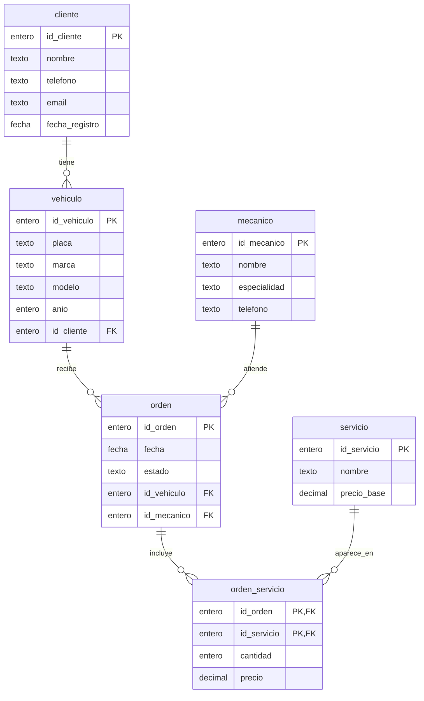

# Modelo de datos del taller mecánico

Documento de diseño para la base de datos SQLite del sistema de información del taller. Esta fase describe el modelo y las restricciones previstas; no contiene un script SQL ni código C#.

## 1. Entidades y atributos

La llave primaria (PK) identifica de forma única cada registro.

| Entidad | Atributos |
|---|---|
| cliente | **id_cliente (PK)**, nombre, telefono, email, fecha_registro |
| vehiculo | **id_vehiculo (PK)**, placa, marca, modelo, anio |
| mecanico | **id_mecanico (PK)**, nombre, especialidad, telefono |
| servicio | **id_servicio (PK)**, nombre, precio_base |
| orden | **id_orden (PK)**, fecha, estado |

## 2. Relaciones y cardinalidades

| Relación | Cardinalidad | Interpretación |
|---|---|---|
| tiene | cliente 1:N vehiculo | Un cliente puede tener varios vehículos; cada vehículo pertenece a un cliente. |
| recibe | vehiculo 1:N orden | Un vehículo puede recibir varias órdenes; cada orden corresponde a un vehículo. |
| atiende | mecanico 1:N orden | Un mecánico puede atender varias órdenes; cada orden tiene un mecánico responsable. |
| incluye | orden N:M servicio | Una orden puede incluir varios servicios y un servicio puede aparecer en varias órdenes. Sus atributos propios son cantidad y precio. |

Se permite registrar clientes sin vehículos, vehículos sin órdenes, mecánicos sin órdenes y servicios todavía no utilizados. Una orden puede comenzar sin servicios mientras se captura. Cada vehículo debe tener un cliente y cada orden debe tener un vehículo y un mecánico.

En incluye, cantidad representa las unidades del servicio y precio representa el precio unitario acordado para esa orden. Este precio conserva el importe histórico aunque cambie el precio_base del catálogo. El importe de una línea se calcula como cantidad por precio.

## 3. Diagrama del modelo

El diagrama muestra la relación N:M resuelta mediante la entidad asociativa orden_servicio. Los tipos son orientativos; no constituyen definiciones SQL.

## 4. Modelo relacional resultante

Una llave foránea (FK) referencia la llave primaria de otra tabla. Las FK de las relaciones 1:N se agregan a la tabla del lado N.

| Tabla | Columnas | PK | FK y destino |
|---|---|---|---|
| clientes | id_cliente, nombre, telefono, email, fecha_registro | id_cliente | Ninguna |
| vehiculos | id_vehiculo, placa, marca, modelo, anio, id_cliente | id_vehiculo | id_cliente → clientes.id_cliente |
| mecanicos | id_mecanico, nombre, especialidad, telefono | id_mecanico | Ninguna |
| servicios | id_servicio, nombre, precio_base | id_servicio | Ninguna |
| ordenes | id_orden, fecha, estado, id_vehiculo, id_mecanico | id_orden | id_vehiculo → vehiculos.id_vehiculo; id_mecanico → mecanicos.id_mecanico |
| orden_servicio | id_orden, id_servicio, cantidad, precio | **(id_orden, id_servicio), compuesta** | id_orden → ordenes.id_orden; id_servicio → servicios.id_servicio |

Cada combinación de orden y servicio aparece una sola vez en orden_servicio. Si se repite el mismo servicio en una orden, se aumenta cantidad; el modelo no admite varias líneas del mismo servicio con precios distintos dentro de esa orden.

## 5. Restricciones planeadas para el script

### Identificación y referencias

- **PRIMARY KEY:** las llaves indicadas en el modelo relacional identificarán cada fila. En orden_servicio, la llave será la combinación de id_orden e id_servicio.
- **FOREIGN KEY:** se aplicará a las cinco referencias indicadas en la tabla anterior para impedir referencias a registros inexistentes. En SQLite deberá habilitarse la comprobación de llaves foráneas en cada conexión.
- **NOT NULL:** todos los atributos serán obligatorios salvo clientes.email, que será opcional. Esto incluye las FK y ambos componentes de la PK compuesta, que no podrán quedar vacíos.

### Unicidad

| Restricción | Columna | Propósito |
|---|---|---|
| UNIQUE | clientes.telefono | Evitar que dos clientes compartan el mismo teléfono registrado, por decisión del modelo. |
| UNIQUE | vehiculos.placa | Evitar registrar dos vehículos con la misma placa. |
| UNIQUE | servicios.nombre | Evitar nombres duplicados en el catálogo de servicios. |

### Validación de valores

| Restricción | Columna | Regla prevista |
|---|---|---|
| CHECK | vehiculos.anio | Entre 1980 y 2027, ambos incluidos. |
| CHECK | servicios.precio_base | Mayor que 0. |
| CHECK | ordenes.estado | IN ('abierta','terminada'): únicamente esos dos valores. |
| CHECK | orden_servicio.cantidad | Mayor que 0. |

### Valores predeterminados

| Restricción | Columna | Valor previsto |
|---|---|---|
| DEFAULT | clientes.fecha_registro | Fecha actual al insertar el registro. |
| DEFAULT | ordenes.fecha | Fecha actual al insertar el registro. |
| DEFAULT | ordenes.estado | 'abierta'. |
| DEFAULT | orden_servicio.cantidad | 1. |

Los valores predeterminados se aplican cuando se omite la columna al insertar; no sustituyen un valor nulo explícito ni actualizan automáticamente las fechas después.

## 6. Preguntas de defensa

1. **¿Por qué orden y servicio tienen una relación N:M?** Una orden puede incluir varios servicios y el mismo servicio puede utilizarse en muchas órdenes.
2. **¿Por qué la FK se coloca del lado N en una relación 1:N?** Cada registro del lado N referencia un único registro del lado 1, sin almacenar listas ni repetir columnas.
3. **¿Por qué la PK de orden_servicio es compuesta?** La combinación identifica una línea y evita repetir el mismo servicio dentro de una orden.
4. **¿Por qué cantidad y precio pertenecen a la relación incluye?** Dependen de la combinación concreta de orden y servicio, no solamente del servicio del catálogo.
5. **¿Para qué sirve PRIMARY KEY?** Identifica cada fila de forma única y permite que otras tablas la referencien.
6. **¿Para qué sirve FOREIGN KEY?** Mantiene la integridad referencial: por ejemplo, impide asociar una orden con un vehículo inexistente.
7. **¿Para qué sirve NOT NULL?** Obliga a proporcionar los datos requeridos y evita relaciones obligatorias sin referencia.
8. **¿Para qué sirve UNIQUE?** Evita duplicados en datos como el teléfono del cliente, la placa y el nombre del servicio, aunque no sean la PK.
9. **¿Para qué sirve CHECK?** Rechaza valores que incumplen reglas, como años fuera del intervalo, precios base no positivos, estados desconocidos o cantidades no positivas.
10. **¿Para qué sirve DEFAULT?** Asigna un valor cuando se omite una columna, como la fecha actual, el estado 'abierta' o la cantidad 1.
